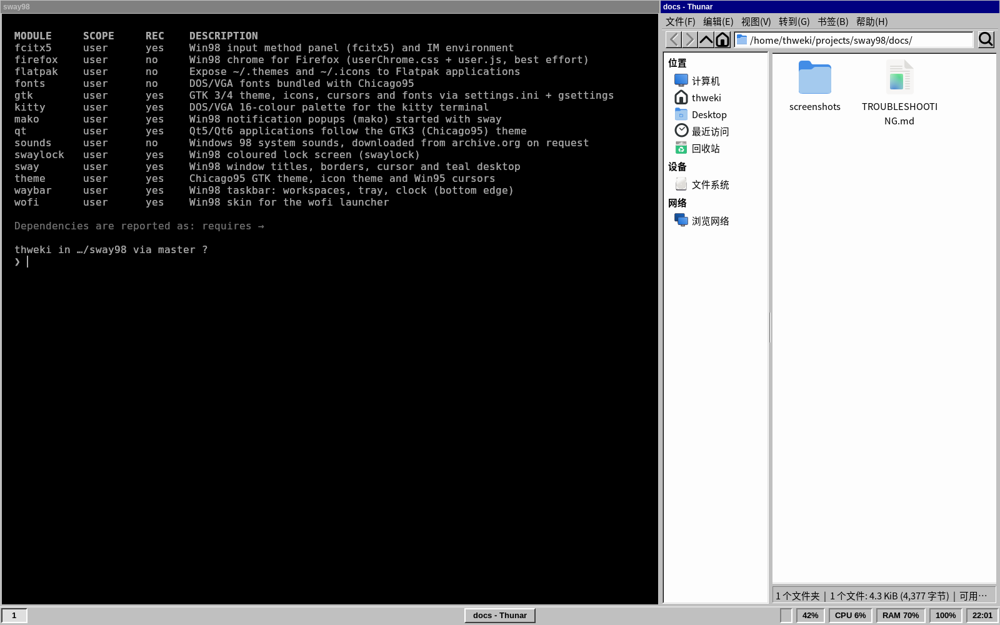
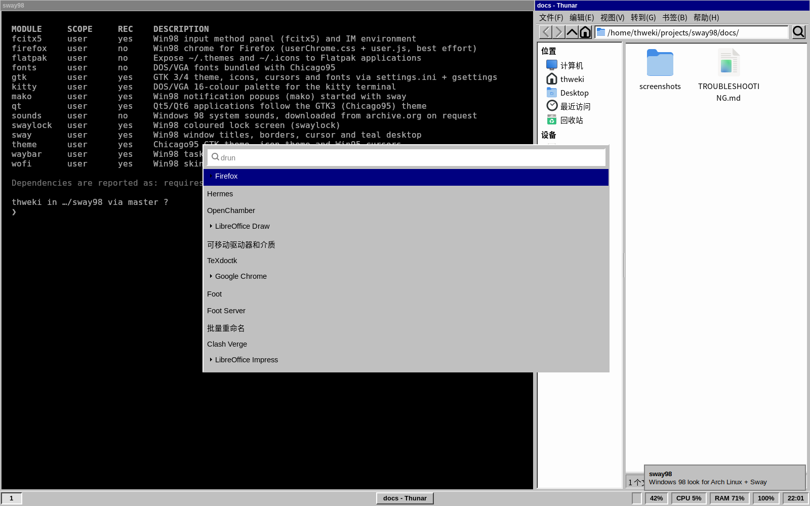

# sway98

**Windows 98 look for Arch Linux + Sway — installed by one command, removed by another.**

sway98 is not another theme: it is the orchestration layer around
[Chicago95](https://github.com/grassmunk/Chicago95) that turns a fresh Arch +
Sway install into a convincing Windows 98 workstation, and — the part most rice
guides skip — records every change in a manifest so `./uninstall.sh` puts your
system back exactly as it was.

```
git clone https://github.com/thweki/sway98 && cd sway98
./install.sh --dry-run          # see every change, touch nothing
./install.sh                    # pick modules, install, done
./uninstall.sh                  # roll everything back
```

## Screenshots



*The Win98 taskbar, the DOS-coloured terminal and Chicago95's icon theme in a GTK file manager — rendered by [`tests/screenshots.sh`](tests/screenshots.sh) in a throwaway headless session, so the pictures show what the modules actually ship.*

<p align="center">
  
  
</p>

**What it changes**

Every module is optional. Nothing is preselected: you choose, module by module.

| Module | What you get | Scope |
|---|---|---|
| `theme` | Chicago95 GTK theme, icon theme and Win95 cursors | user |
| `sway` | 3px grey window frames, `#000080` focused title bars, teal `#008080` desktop, Win95 cursor | user |
| `waybar` | A Win98 taskbar along the bottom edge: raised workspace buttons, recessed tray | user |
| `gtk` | GTK 3/4 theme, icons, cursors and fonts via `settings.ini` + gsettings | user |
| `qt` | Qt 5 **and** Qt 6 applications follow the GTK theme (`QT_QPA_PLATFORMTHEME=gtk3`) | user |
| `kitty` | The DOS/VGA 16-colour terminal palette | user |
| `wofi` | Launcher with grey dialog body and recessed input field | user |
| `mako` | Notification popups in dialog style, started with the session | user |
| `swaylock` | Lock screen in title-bar blue with a grey ring | user |
| `fcitx5` | Win98 input method panel + the D-Bus environment fcitx5 needs under sway | user |
| `firefox` | Blue gradient title bar, square tabs, recessed address bar (best effort) | user |
| `fonts` | The DOS/VGA fonts that ship with Chicago95 | user |
| `flatpak` | Lets sandboxed applications see `~/.themes` and `~/.icons` | user |
| `sounds` | Windows 98 system sounds, downloaded on request (see below) | user |
| `sddm` | Windows 98 login screen | system *(planned)* |
| `plymouth` | Windows 98 boot splash | system *(planned)* |

## How it stays reversible

* **Manifest.** Every file it touches is recorded in
  `~/.local/state/sway98/manifest/` with its old hash and a copy of the old
  contents. `./uninstall.sh` replays that in reverse: commands, files, then the
  directories that were created and left empty. Successful records are archived;
  failed commands, missing backups, and other rollback failures stay active and
  make uninstall exit nonzero. Fix the reported problem and run uninstall again
  to retry. `--only MODULE` consumes that module's successful records and keeps
  other modules and unresolved records active.
* **No clobbering.** Existing configuration is never overwritten silently. The
  sway window colours go into `~/.config/sway/conf.d/sway98.conf`, which is added
  to your config as a marker-delimited `include` block (`# >>> sway98 >>>`), so
  re-running the installer cannot stack duplicate lines.
* **Dry run.** `./install.sh --dry-run --all` prints every intended change and
  writes nothing at all — not even the manifest.
* **Idempotent.** Running the installer again only writes what actually differs.

## Microsoft assets

The repository contains **no** Microsoft artwork, sounds or fonts — only the
address and checksum of the Internet Archive item that holds them:

```
modules/sounds/sources.tsv     # freedesktop name, archive.org item, path, sha1
modules/sounds/fetch-ms-sounds.sh
```

The `sounds` module offers to download them to your machine; if you decline,
nothing is downloaded and the module installs nothing. The boot and shutdown
sounds, the error chimes and the theme's font are all Microsoft copyright — keep
that in mind before publishing screenshots that contain them.

One detail worth knowing: `fetch-ms-sounds.sh` does **not** use the obvious
`https://archive.org/download/<item>/<path>` URL. That redirects to storage
nodes which drop the TLS handshake on some networks (5 out of 5 attempts failed
for us, while the same file downloaded fine from the node the metadata API
reported). The script therefore resolves `server` and `dir` through
`https://archive.org/metadata/<item>` first and verifies the sha1 afterwards.

## Requirements

Arch Linux (or a derivative — anything with `pacman`) running **Sway on
Wayland**. The installer reports missing packages and never installs them behind
your back:

```
sudo pacman -S --needed sway waybar kitty wofi mako swaylock fcitx5 fcitx5-gtk \
    fcitx5-qt gtk3 gtk4 qt5-base qt6-base ttf-liberation noto-fonts-cjk \
    ttf-jetbrains-mono-nerd libcanberra sound-theme-freedesktop
```

Optional: `paru` or `yay` for the AUR copy of Chicago95, `gum` for a nicer
module picker, `grim`/`slurp` for screenshots.

## Options

```
./install.sh --list                  list modules and exit
./install.sh --dry-run --all         full rehearsal, zero side effects
./install.sh --modules theme,gtk,sway
./install.sh --recommended           the set that gives you the look fastest
./install.sh --only waybar           add or refresh a single module
./uninstall.sh --dry-run             see the rollback first
./uninstall.sh --only firefox        roll back one module
```

## Honest limitations

| Looks | Applications |
|---|---|
| **Right** | GTK 3/4 apps with Chicago95 loaded, Sway decorations, Waybar, kitty, wofi, mako, swaylock, fcitx5, Qt apps via `QT_QPA_PLATFORMTHEME=gtk3` |
| **Partly** | Qt apps (colour scheme and widgets follow GTK, but not pixel for pixel), Firefox (userChrome.css breaks on Mozilla's DOM changes), Flatpak apps before the override takes effect |
| **Not at all** | libadwaita/GNOME 4x apps — they ignore `gtk-theme-name` by design; Electron apps unless they are told to use GTK 3; X11-only apps' decorations |

Also: this is a **Sway** project. There is no Hyprland/niri support, no
Debian/Fedora packaging, and `sddm`/`plymouth` (which touch system paths) are not
implemented yet.

## Troubleshooting

See [docs/TROUBLESHOOTING.md](docs/TROUBLESHOOTING.md). The three that bite
everyone: GTK applications only read their theme at startup (restart them),
Firefox needs a full quit (`Ctrl+Shift+Q`) rather than a window reload, and Qt
applications need a new login before `QT_QPA_PLATFORMTHEME` reaches them.

## Development

Everything is Bash; there is no build step, and the installer's only runtime
dependencies are `curl`, `git` and coreutils.

```
make check              # shellcheck, dry run, roundtrip, rollback failure/retry tests
make check-real         # the same against a real Chicago95 checkout
tests/screenshots.sh    # regenerate the images in docs/screenshots/
```

`make check` needs `shellcheck` (`pacman -S shellcheck` / `apt install shellcheck`).
Every test runs against a throwaway `$HOME` under `tests/sandbox/`, so nothing on
the machine running them is modified — including the screenshot generator, which
renders a private headless sway session instead of photographing your own desktop.

The module contract (one `modules/<id>/module.sh`, optionally with `files/`) and
the invariants the test suite enforces are written down in [AGENTS.md](AGENTS.md)
(in Chinese, like the rest of the working notes). The implementation plan and the
decision log stay local to the maintainer's machine and are not part of the
repository.

## Credits

sway98 is a thin layer on other people's work. The full list with licenses is in
[CREDITS.md](CREDITS.md); the short version: **Chicago95** by grassmunk and
contributors (theme, icons, cursors, Qt colour scheme, VGA fonts), **VileR /
int10h.org** (DOS VGA fonts), plus Sway, Waybar, wofi, mako, kitty, fcitx5,
Kvantum, and the Arch Wiki.

## License

GPL-3.0-or-later — matching Chicago95. See [LICENSE](LICENSE).
