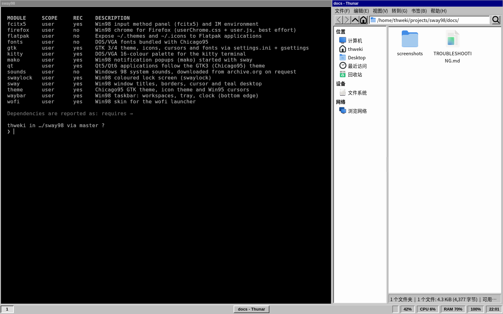
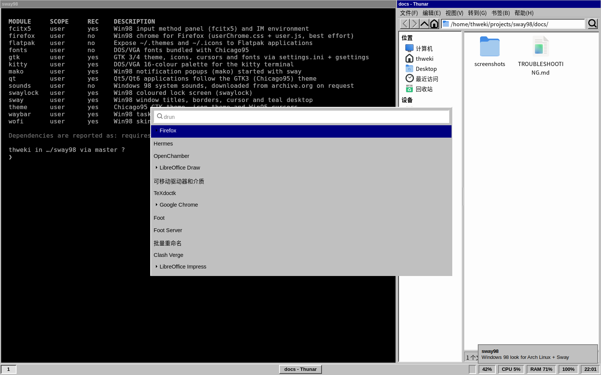

# sway98

**给 Arch Linux + Sway 的 Windows 98 外观：一条命令装，一条命令卸。**

sway98 不是又一个主题，而是包在 [Chicago95](https://github.com/grassmunk/Chicago95)
外面的编排层：把一台刚装好的 Arch + Sway 变成像样的 Windows 98 工作站，
并且把每一处改动记进 manifest —— `./uninstall.sh` 能把系统精确还原。

> 英文 README（发布用）见 [README.md](README.md)。中文版供本地阅读，可能滞后于英文版。

```
git clone https://github.com/thweki/sway98 && cd sway98
./install.sh --dry-run          # 预演：只打印将要做的每一次改动
./install.sh                    # 交互勾选模块并安装
./uninstall.sh                  # 全部回滚
```

## 效果截图



*底部 Win98 任务栏、DOS 配色的终端、GTK 文件管理器里的 Chicago95 图标 —— 由 [`tests/screenshots.sh`](tests/screenshots.sh) 在一次性无头会话里生成，所以图里就是各模块真正装出来的样子。*

<p align="center">
  
  
</p>

## 会改什么

每个模块都独立可选，默认**一个都不勾**。

| 模块 | 内容 | 作用域 |
|---|---|---|
| `theme` | Chicago95 的 GTK 主题、图标主题、Win95 光标 | user |
| `sway` | 3px 灰边框、聚焦窗 `#000080` 深蓝标题栏、`#008080` 青绿桌面、Win95 光标 | user |
| `waybar` | 底部 Win98 任务栏（凸起工作区按钮、凹陷托盘） | user |
| `gtk` | GTK 3/4 的主题/图标/光标/字体（`settings.ini` + gsettings 双写） | user |
| `qt` | Qt5 与 Qt6 同时跟随 GTK 主题（`QT_QPA_PLATFORMTHEME=gtk3`） | user |
| `kitty` | DOS/VGA 16 色终端调色板 | user |
| `wofi` | 启动器：灰底对话框 + 白底凹陷输入框 | user |
| `mako` | 对话框风格通知，随会话启动 | user |
| `swaylock` | 深蓝锁屏 + 灰色指示环 | user |
| `fcitx5` | Win98 输入法候选栏 + sway 下必需的 D-Bus 环境 | user |
| `firefox` | 蓝色渐变标题栏、方形标签、凹陷地址栏（best effort） | user |
| `fonts` | Chicago95 自带的 DOS/VGA 位图字体 | user |
| `flatpak` | 让沙箱应用能读到 `~/.themes` 与 `~/.icons` | user |
| `sounds` | Win98 系统音效，按需下载（见下） | user |
| `sddm` | Win98 登录界面 | system（计划中） |
| `plymouth` | Win98 开机动画 | system（计划中） |

## 为什么敢用

- **manifest 记账**：每个被改动的文件在 `~/.local/state/sway98/manifest/` 里都有记录（旧哈希 + 备份副本），卸载按逆序回放：命令 → 文件 → 空目录。
- **不覆盖**：sway 配色写进 `~/.config/sway/conf.d/sway98.conf`，以标记块 `# >>> sway98 >>>` 的形式 include 到你的配置末尾；重复安装不会叠加。
- **零副作用预演**：`./install.sh --dry-run --all` 连 manifest 都不写。
- **幂等**：重复安装只写真正有变化的文件。

## 微软素材

仓库里**没有任何**微软美术、音效、字体文件，只有地址与校验值：

```
modules/sounds/sources.tsv      # freedesktop 音效名、archive.org item、路径、sha1
modules/sounds/fetch-ms-sounds.sh
```

`sounds` 模块会询问是否下载到本机；拒绝则什么都不装。启动/关机音、错误提示音
以及主题字体都属微软版权，发截图前留意这一点。

下载器**不用** `https://archive.org/download/...` 那个显而易见的地址：它的 302
会跳到某些网络下 TLS 直接断连的存储节点（实测连续 5 次失败，而走 metadata API
给出的节点一次成功）。脚本先查 `https://archive.org/metadata/<item>` 拿到
`server`/`dir`，直连下载后再校验 sha1。

## 依赖

Arch Linux（或任何带 `pacman` 的衍生版）+ **Sway/Wayland**。安装器只报告缺失的包，
不会替你装：

```
sudo pacman -S --needed sway waybar kitty wofi mako swaylock fcitx5 fcitx5-gtk \
    fcitx5-qt gtk3 gtk4 qt5-base qt6-base ttf-liberation noto-fonts-cjk \
    ttf-jetbrains-mono-nerd libcanberra sound-theme-freedesktop
```

可选：`paru`/`yay`（AUR 版 Chicago95）、`gum`（更好看的模块选择界面）、`grim`/`slurp`（截图）。

## 参数

```
./install.sh --list                  列出模块
./install.sh --dry-run --all         完整预演
./install.sh --modules theme,gtk,sway
./install.sh --recommended           推荐集（最快看到效果）
./install.sh --only waybar           单独装/刷新一个模块
./uninstall.sh --dry-run             先看回滚清单
./uninstall.sh --only firefox        只回滚一个模块
```

## 如实说明的边界

| 程度 | 对象 |
|---|---|
| **像** | 加载了芝加哥主题的 GTK3/4 应用、Sway 窗口装饰、Waybar、kitty、wofi、mako、swaylock、fcitx5、走 `gtk3` 平台主题的 Qt 应用 |
| **半像** | Qt 应用（配色与控件跟随 GTK，但非像素级）、Firefox（userChrome 依赖内部 DOM，Mozilla 改版会碎）、生效前的 Flatpak 应用 |
| **不像** | libadwaita/GNOME 4x 应用（设计上忽略 `gtk-theme-name`）、未指定 GTK3 的 Electron 应用、纯 X11 应用的装饰 |

另外：本项目只做 **Sway**，不做 Hyprland/niri，不提供 deb/rpm 打包，
`sddm`/`plymouth` 这两个动系统路径的模块尚未实现。

## 故障排查

见 [docs/TROUBLESHOOTING.md](docs/TROUBLESHOOTING.md)。最常遇到的三件事：
GTK 应用只在启动时读主题（要重启）、Firefox 必须完全退出（`Ctrl+Shift+Q`）再开、
Qt 应用的 `QT_QPA_PLATFORMTHEME` 需要重新登录才会到达。

## 开发

全部是 Bash，没有构建步骤；安装器的运行期依赖只有 `curl`、`git` 和 coreutils。

```
make check              # shellcheck + 干跑 + 装/卸往返
make check-real         # 对真实 Chicago95 跑一遍同样的流程
tests/screenshots.sh    # 重生成 docs/screenshots/ 里的截图
```

`make check` 需要 `shellcheck`（`pacman -S shellcheck` / `apt install shellcheck`）。
所有测试都跑在 `tests/sandbox/` 里的一次性 `$HOME` 下，不会改动运行它的机器——
截图生成器也一样：它渲染一个私有的一次性无头 sway 会话，而不是给你的桌面拍照。

模块契约（一个 `modules/<id>/module.sh`，可选 `files/`）与测试所强制的不变量写在
[AGENTS.md](AGENTS.md)；实施计划与设计决策的理由写在 [PLAN.md](PLAN.md)。

## 鸣谢与授权

完整清单见 [CREDITS.md](CREDITS.md)。简版：**Chicago95**（grassmunk 与贡献者）、
**VileR / int10h.org**（DOS VGA 字体），以及 Sway、Waybar、wofi、mako、kitty、
fcitx5、Kvantum 与 Arch Wiki。

授权：GPL-3.0-or-later，与 Chicago95 一致。见 [LICENSE](LICENSE)。
